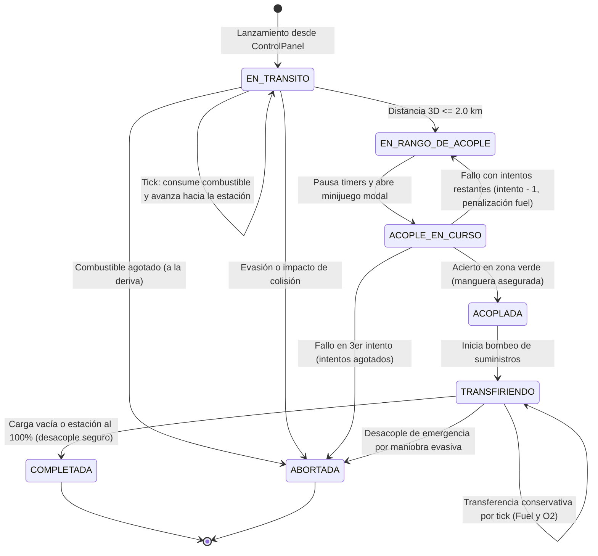

# Reporte de Implementación: Misiones de Reabastecimiento Orbital

## 1. Resumen Ejecutivo
1. Se implementó el ciclo de vida completo de las misiones de reabastecimiento orbital mediante la clase `CargoShip`, orquestadas por un nuevo `MissionController` con desacoplamiento estricto de N2YO (la API sólo provee estaciones espaciales).
2. Se desarrolló un minijuego de precisión táctico con desacoplamiento entre el modelo matemático (`PrecisionGauge`) y la vista modal Swing (`DockingMinigameDialog`), capturando la barra espaciadora mediante `KeyBindings` e incorporando las imágenes de aproximación y fallo.
3. Se garantizó la conservación estricta de masa en la transferencia de combustible y oxígeno, se introdujo `AlertQueue` para prevenir solapamiento de modales y se validó el sistema con 15 pruebas unitarias automatizadas.

---

## 2. Máquina de Estados de la Misión



---

## 3. Clases Creadas y Modificadas

### Clases Creadas

1. **`model.spacecraft.MissionState`**:
   - *Propósito:* Enumeración de estados finitos (`EN_TRANSITO`, `EN_RANGO_DE_ACOPLE`, `ACOPLE_EN_CURSO`, `ACOPLADA`, `TRANSFIRIENDO`, `COMPLETADA`, `ABORTADA`).
   - *Patrón/Principio:* State Pattern / Encapsulamiento de comportamiento según estado.

2. **`model.minigame.PrecisionGauge`**:
   - *Propósito:* Modelo matemático puro del minijuego (posición 0-100, velocidad, rebote elástico ping-pong, límites de zona verde y evaluación de acierto).
   - *Patrón/Principio:* Single Responsibility Principle (SRP) y separación Modelo-Vista (totalmente independiente de Swing/AWT, 100% testeable sin interfaz gráfica).

3. **`controller.MissionController`**:
   - *Propósito:* Controlador especialista paralelo a `CrisisController`. Gestiona validaciones de spawn (estación seleccionada, límite de 3 cargueros activos, estación no llena), avance de misiones por tick y coordinación de eventos.
   - *Patrón/Principio:* GRASP Controller y Alta Cohesión (High Cohesion), evitando saturar `SimulationController`.

4. **`controller.AlertQueue`**:
   - *Propósito:* Cola de despachador modal FIFO. Garantiza que nunca existan dos ventanas modales abiertas simultáneamente y gestiona la pausa y reanudación atómica de los timers de la simulación.
   - *Patrón/Principio:* Synchronization Dispatcher / Single Responsibility Principle.

5. **`gui.DockingMinigameDialog`**:
   - *Propósito:* Ventana modal `JDialog` táctica (`setUndecorated(true)`), animada a ~60 FPS. Muestra la imagen de acoplamiento (`CargoShipProgress_Acoplamiento.jpg`), la barra horizontal con zona verde y marcador amarillo. Al presionar ESPACIO muestra el cartel de éxito o cambia a la imagen de fallo (`CargoShipProgress_AcoplamientoFallido.jpg`).
   - *Patrón/Principio:* Separation of Concerns (Vista pura que consume `PrecisionGauge`) y robustez de entrada con `KeyBindings` (`WHEN_IN_FOCUSED_WINDOW`).

6. **`gui.MissionDialogView`**:
   - *Propósito:* Vistas modales informativas unificadas con la estética cibernética de `CrisisDialogView` ("Acople exitoso", "Acople fallido", "Carguero sin combustible", "Reabastecimiento completado").
   - *Patrón/Principio:* Reusabilidad visual y consistencia de diseño.

7. **`test.PrecisionGaugeCheck`**:
   - *Propósito:* Suite de pruebas unitarias para el modelo del minijuego (acierto centro, bordes inclusivos, fallos fuera, rebote en extremos y calibración de dificultad).

8. **`test.ResupplyMissionCheck`**:
   - *Propósito:* Suite de pruebas unitarias para misiones (conservación de masa, estanqueidad de tanques, agotamiento de combustible en vuelo, 3 fallos de acople y validaciones de spawn).

### Clases Modificadas

1. **`model.spacecraft.CargoShip`**:
   - *Cambios:* Se incorporaron campos de misión (`targetStation`, `missionState`, `cargoFuel`, `cargoOxygen`, `dockingAttemptsRemaining`), cinemática 3D de navegación hacia la estación, consumo de propulsión, penalizaciones de maniobra y transferencia conservativa de masa por tick. Se actualizó la imagen por defecto a `CargoShipProgress.jpg`.
   - *Principio:* Experto en Información (Information Expert): la nave sabe su destino, calcula su avance y transfiere su carga sin que agentes externos manipulen sus atributos privados.

2. **`model.components.FuelTank`**:
   - *Cambios:* Se agregó el método `isFull()`.
   - *Principio:* Information Expert (junto a `isEmpty()`).

3. **`engine.SimulationEngine`**:
   - *Cambios:* Se aisló `syncWithN2YO()` con `if (!(craft instanceof SpaceStation)) continue;`. Se incorporaron los métodos `spawnCargoShip(station)` y `getActiveCargoShips()`.
   - *Principio:* Open/Closed Principle y aislamiento de red.

4. **`gui.ControlPanel`**:
   - *Cambios:* Se agregó el botón táctico `[>] Lanzar Carguero` con validación de estados y su correspondiente listener y getter.
   - *Principio:* Inversión de Dependencias (la vista emite eventos; el controlador los escucha).

5. **`gui.RadarPanel`**:
   - *Cambios:* Se implementó el ícono propio para cargueros (rombo táctico naranja con reborde ámbar) y el trazado de trayectorias hacia la estación (línea punteada en vuelo y línea sólida verde brillante cuando la manguera está acoplada).

6. **`controller.SimulationController`**:
   - *Cambios:* Se integró `AlertQueue` y `MissionController`, vinculando el evento de lanzamiento y la evaluación por tick de misiones.

---

## 4. Separación N2YO (Solo Estaciones) vs. Naves Generadas

- **Aislamiento en red:** En `SimulationEngine.syncWithN2YO()`, se verificó que el ciclo de actualización satelital solo interactúe con instancias de `SpaceStation`. Si en la lista hay cargueros, basura espacial o sondas locales, se descartan de la sincronización HTTP (`continue`).
- **Independencia telemétrica:** Los cargueros son generados con IDs sintéticos (ej. NORAD 70001, 70002) y coordenadas locales generadas dinámicamente alrededor de la estación seleccionada (entre 80 y 160 km de distancia 3D). Ningún request de red interfiere con su cinemática ni su combustible.

---

## 5. Funcionamiento del Minijuego y Ajuste de Dificultad

1. **Mecánica:**
   - La barra horizontal representa un rango normalizado de 0.0 a 100.0.
   - La zona verde está centrada en 50.0.
   - El marcador amarillo oscila de izquierda a derecha rebotando en 0.0 y 100.0.
   - El usuario presiona **ESPACIO**. Si el marcador está dentro del intervalo verde, la manguera conecta.
2. **Imágenes dinámicas:**
   - Durante la oscilación se visualiza `CargoShipProgress_Acoplamiento.jpg`.
   - Al acertar: se congela el marcador, se muestra el mensaje de éxito en verde durante 1.2 segundos y se inicia la transferencia.
   - Al fallar: se intercambia dinámicamente la imagen por `CargoShipProgress_AcoplamientoFallido.jpg`, se muestra el mensaje de fallo con el número de intento restante durante 1.5 segundos y se consume combustible por penalización de corrección orbital.
3. **Calibración de dificultad (en `PrecisionGauge.java`):**
   - **Intento 1:** Velocidad = `1.3`, Ancho zona verde = `24.0` (rango 38.0 a 62.0).
   - **Intento 2:** Velocidad = `1.7`, Ancho zona verde = `20.0` (rango 40.0 a 60.0).
   - **Intento 3:** Velocidad = `2.1`, Ancho zona verde = `16.0` (rango 42.0 a 58.0).
   - Los parámetros se pueden ajustar fácilmente modificando las constantes en `PrecisionGauge.java:50-65`.

---

## 6. Resultados de las Pruebas Automatizadas

Se ejecutaron las 3 suites de pruebas del proyecto (`test.GeoPositionCheck`, `test.PrecisionGaugeCheck`, `test.ResupplyMissionCheck`):

| Suite | Caso de Prueba | Valor Esperado | Valor Obtenido | Estado |
|---|---|---|---|---|
| **GeoPosition** | Mismo punto exacto | 0.0 km | 0.0 km | **PASÓ** |
| **GeoPosition** | Misma vertical, distinta cota (ISS vs GEO) | 35.386,0 km | 35.386,0 km | **PASÓ** |
| **GeoPosition** | Cuerda 3D vs arco orbital | 590,69 km | 590,6937 km | **PASÓ** |
| **GeoPosition** | Haversine a nivel del mar | 555,97 km | 555,9746 km | **PASÓ** |
| **GeoPosition** | Delegación polimórfica 3D | Idéntico | Idéntico | **PASÓ** |
| **PrecisionGauge** | Frenado en centro verde (50.0) | Acierto (true) | Acierto (true) | **PASÓ** |
| **PrecisionGauge** | Frenado en bordes inclusivos (40.0 y 60.0) | Acierto (true) | Acierto (true) | **PASÓ** |
| **PrecisionGauge** | Frenado fuera de zona (25.0 y 75.0) | Fallo (false) | Fallo (false) | **PASÓ** |
| **PrecisionGauge** | Rebote ping-pong en extremos (0.0 y 100.0) | Cambio de dirección | Correcto | **PASÓ** |
| **PrecisionGauge** | Progresión de dificultad (intentos 1, 2, 3) | Vel sube, ancho baja | Correcto | **PASÓ** |
| **ResupplyMission** | Conservación estricta de masa | Delta Cargo == Delta Estación | 200 L Fuel / 15% O2 idénticos | **PASÓ** |
| **ResupplyMission** | Estación casi llena (tope sin desbordes) | Máx 2500 L Fuel, 100% O2 | 2500 L y 100.0% exactos | **PASÓ** |
| **ResupplyMission** | Agotamiento de combustible en vuelo | Estado ABORTADA | Correcto | **PASÓ** |
| **ResupplyMission** | Agotamiento de 3 intentos de acople | Estado ABORTADA | Correcto | **PASÓ** |
| **ResupplyMission** | Validaciones de spawn (llena y límite 3) | Rechazo con aviso | Correcto | **PASÓ** |

---

## 7. Limitaciones Conocidas y Recomendaciones

1. **Sensibilidad de la barra espaciadora:** En sistemas con configuraciones de accesibilidad de repetición rápida de teclas, presionar y mantener la barra espaciadora podría generar múltiples disparos de evento. El código lo previene con el flag booleano `gauge.isStopped()`, pero se recomienda no mantener apretada la tecla.
2. **Escala visual en distancias mínimas:** Cuando el carguero está a menos de 2 km de la estación, en el radar 2D ambos íconos prácticamente se solapan debido a la resolución espacial. La línea de conexión sólida y el panel de telemetría lateral clarifican el estado de acople.
3. **Tasa de transferencia ajustable:** La velocidad de descarga está fijada en 45 L de combustible y 2.5% de oxígeno por tick. Si se desea una transferencia más rápida o más lenta, se puede configurar en las constantes de `CargoShip.java`.

---

## 8. Pasos para Probar desde la Interfaz Gráfica (GUI)

1. **Compilar el proyecto:**
   ```bash
   javac -encoding UTF-8 -d bin src/model/geometry/*.java src/model/components/*.java src/model/spacecraft/*.java src/model/minigame/*.java src/radar/*.java src/api/*.java src/engine/*.java src/controller/*.java src/gui/*.java src/test/*.java src/Main.java
   ```
2. **Iniciar la aplicación:**
   ```bash
   java -cp bin gui.MainGUI
   ```
3. **Conectar la simulación:**
   - Seleccionar la estación (ISS o Tiangong) y pulsar `>> INICIAR SIMULACIÓN`.
4. **Lanzar un carguero:**
   - Consumir algo de combustible en la estación si estuviera llena o pulsar directamente `[>] Lanzar Carguero`.
   - Observar cómo aparece el carguero `KPS-Cargo-01` en el ComboBox, en la telemetría lateral con la imagen `CargoShipProgress.jpg` y en el radar como un rombo naranja con línea punteada hacia la estación.
5. **Aproximación y Minijuego:**
   - A medida que transcurren los ticks, el carguero se acerca a la estación.
   - Al llegar a menos de 2 km, la simulación se pausa automáticamente y se despliega la ventana del minijuego con la imagen `CargoShipProgress_Acoplamiento.jpg`.
   - **Probar un fallo:** Presionar ESPACIO cuando el marcador esté fuera de la zona verde. Se verá la imagen de fallo `CargoShipProgress_AcoplamientoFallido.jpg` y el contador de intentos restantes.
   - **Probar un acierto:** Presionar ESPACIO dentro de la zona verde. Se verá el mensaje de éxito en verde, la manguera quedará conectada y se abrirá la modal de acople exitoso.
6. **Transferencia y Desacople:**
   - En el radar, la línea hacia la estación se vuelve sólida verde.
   - En la consola y en el monitor lateral se aprecia la descarga progresiva de combustible y oxígeno.
   - Al finalizar, salta la modal de informe final con el resumen de suministros entregados y el carguero concluye su misión.
